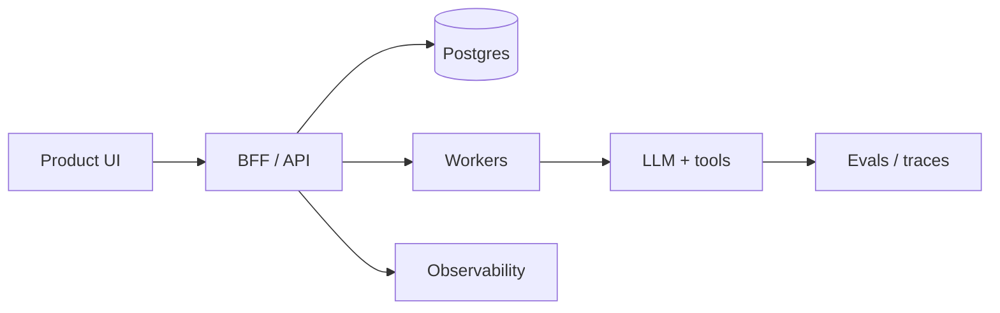

<div align="center">


<br/>

**I design and ship systems people actually want to use.**  
Architecture that holds under load. Interfaces that feel considered. LLM features that are evaluated, not demoed.

<br/>

`Python` · `TypeScript` · `JavaScript` · `React` · `Next.js` · `FastAPI` · `Node` · `PostgreSQL` · `RAG` · `Agents`

<br/>

[Portfolio](#) · [LinkedIn](#) · [Email](#) · [Calendly](#)

</div>

---

## How I work at senior level

I own the path from ambiguous problem to production: product shape, system design, interface, data, and the failure modes in between.

| I am hired for | What that looks like in practice |
| --- | --- |
| **End-to-end ownership** | Spec ? API ? UI ? observability. I do not throw tickets over a wall. |
| **Product judgment** | Cut scope, name trade-offs, ship the 80% that moves the metric. |
| **Interface craft** | Hierarchy, spacing, motion, empty states, and accessibility as defaults. |
| **AI that survives contact with users** | Grounding, evals, cost/latency budgets, human-in-the-loop. |
| **Mentorship without theater** | Reviews that teach, RFCs that decide, standards that stick. |

<details>
<summary><strong>Operating principles</strong></summary>

- Prefer a boring core (typed APIs, Postgres, explicit jobs) and a sharp edge (LLM, real-time, motion).
- Measure before arguing: traces, eval sets, Core Web Vitals, error budgets.
- Design in the repo: tokens, components, and copy live next to the code that ships.
- Security and privacy are product features, not a later epic.

</details>

---

## Interface & product design

I treat UI as a system, not a coat of paint. The banner above is the same language I use in product: restrained palette, 8pt rhythm, scannable metrics, honest empty states.

**What I design for**

- **Clarity first** — one primary action, typed hierarchy, no decorative chrome.
- **States that exist** — loading, empty, partial, error, permission, offline.
- **Motion with a job** — 150–200ms transitions that explain layout change, not bounce.
- **Accessible by construction** — contrast AA, keyboard paths, labels, reduced motion.
- **Handoff that does not leak** — Figma tokens mapped to CSS/Tailwind; components, not screenshots.

```text
tokens ? primitives ? patterns ? screens
  color, type, space     Button, Input     Form, Table     product surfaces
```

**Frontend craft:** React / Next.js, TypeScript, design tokens, component libraries, Storybook, responsive and dark-theme systems, performance (bundle, CLS, TTI).

---

<div align="center">
  
</div>

---

## Full-stack systems

Python and JS/TS on both sides of the wire, with a bias toward typed contracts and boring data stores.

**Backend.** FastAPI / Django / Node. REST and event-driven jobs. AuthN/Z, tenancy, idempotency, migrations you can reverse.

**Data.** PostgreSQL as source of truth. Redis for cache and locks. Queues for work that must not live in the request.

**Quality.** Tests at the seams (API contracts, UI critical paths). CI that fails closed. Feature flags for rollout, not archaeology.

**Cloud.** Containers, GitHub Actions, AWS/GCP-shaped deployments, logs + traces + metrics that map to user journeys.



---

## AI / LLM — production, not prototypes

I build LLM features the way I build any other subsystem: contracts, budgets, tests, and an owner for failure.

| Layer | How I ship it |
| --- | --- |
| **Retrieval** | Chunking, metadata filters, hybrid search, citation-first answers |
| **Orchestration** | Tools with schemas, timeouts, retries, circuit breakers |
| **Agents** | Narrow loops, explicit state, human approval on irreversible actions |
| **Quality** | Golden sets, LLM-as-judge with human spot checks, regression on prompts |
| **Ops** | Token/cost dashboards, p95 latency, prompt versioning, red-team prompts |
| **Safety** | PII handling, allowlists, output validation, least-privilege tools |

Stack I reach for: OpenAI / Anthropic / local models, embeddings, LangGraph or thin custom graphs, structured outputs (JSON schema), Python services with a TypeScript client.

---

## Selected work

Replace these with your real repos and screenshots. Keep the format: **problem ? system ? interface ? outcome**.

### 01 — AI workspace with a real product surface
Multi-tenant app: Next.js UI, FastAPI, Postgres, RAG over private docs.  
**Design:** dense-but-calm console, tokenized theme, streaming responses with source chips.  
**Senior bit:** eval harness + tracing before we scaled the prompt.

### 02 — Design system that paid down frontend debt
Extracted primitives and patterns from a sprawling React app.  
**Design:** 8pt grid, type scale, semantic color, dark mode without a second codebase.  
**Senior bit:** adoption plan, deprecation, and Storybook as the contract.

### 03 — Event-backed platform API
Python workers + Node BFF, idempotent writes, webhook outbox.  
**Design:** operator UI for failed jobs — not a dump of JSON.  
**Senior bit:** SLOs and a runbook, not a hero graph.

---

## Stack at a glance

<p align="center">
  
  
  
  
  
  
  
  
  
  
</p>

---

## Currently

- Tightening **eval + tracing** loops for agentic products  
- Pushing **design-system adoption** (tokens in code, not in a wiki)  
- Writing RFCs that decide **architecture and UX** in the same document  

---

<div align="center">

**Let’s build something that looks as good as it runs.**

If you need a senior engineer who can sit in Figma *and* in the incident channel, say hello.

</div>
